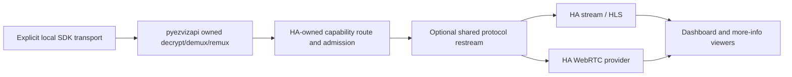
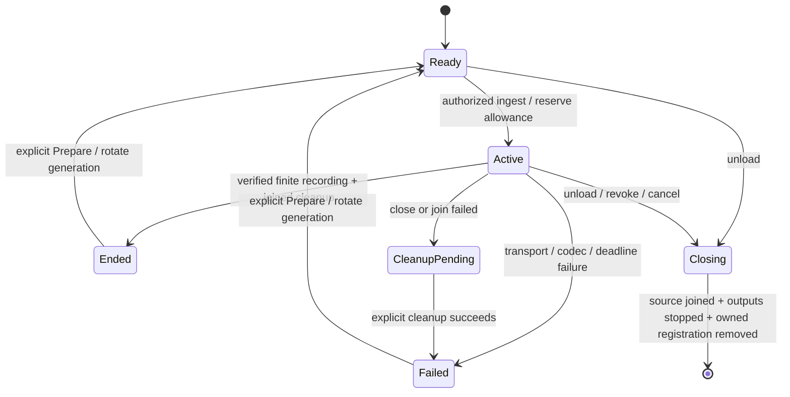

# Native EZVIZ media: Home Assistant consumer architecture

## Decision

Keep pyezvizapi headless and integration-neutral. Let Home Assistant own device
entities, credentials, wake/admission policy, local delivery URLs and downstream
lifecycle. Use HA's existing stream/WebRTC machinery for presentation, and a
standard shared restream boundary when HLS and WebRTC need the same acquisition.
Do not ship a second player, silently transcode, or make the private relay fork
a default library dependency.

This is a staged design, not a claim that the temporary `ezviz_native` example
is production-ready. Existing EZVIZ RTSP cameras and cloud-control behavior must
remain unchanged when native delivery is not explicitly configured.

The existing direct HTTP route can also feed a single HA ingest. It is not a
solution for simultaneous automatic HLS/WebRTC readers: that topology has
reproduced admission conflicts. Do not enable a global HA setting or raise the
native-owner limit to conceal that conflict.

## Ownership boundaries

| Layer | Owns | Must not own |
| --- | --- | --- |
| pyezvizapi | Explicit local transport, incremental framing/decryption, selected encoded tracks, native timestamps, bounded mux output, cancellation/join and sanitized receipts | HA entities/config entries, HTTP listener, go2rtc process/config, frontend decisions, automatic account/wake fallback |
| HA integration runtime | Credential generation, camera/source selection, admission, session generation, capability rotation, HTTP route, unload/recovery and diagnostic state | Private backend timestamp repair or an independent media player |
| Shared delivery adapter | One lazy upstream registration per admitted selected source; downstream reader fan-out; negotiated conditional removal/no-retry/common-clock contracts | New camera acquisition on downstream retry, config-wide deletion, invisible transcoding |
| HA stream/WebRTC providers | HLS segmentation, WebRTC signaling, browser-compatible presentation, player lifecycle | Assuming a failed/unsupported player authorized a fresh battery-camera preview |
| Browser/client | Actual codec decoder availability and picture/audio playback | Proving physical A/V sync from a successful signaling exchange |

The library's public consumer surface remains `NativeMpegTsStream`,
`NativeStreamOptions`, `NativeTrackSelection`, `NativeSourceClock`,
`native_mpegts_stream_from_client`, async chunks and explicit close/recovery.
No HA, aiohttp or go2rtc dependency is added to the library wheel. PyAV remains
an optional streaming extra compatible with the consumer's pin.

## Physical sessions versus camera entities

Use one HA device per physical camera and one camera entity per independently
selectable lens/view. Keep a stable logical lens identifier separate from
current-session PES IDs and absolute discovery indices. Profiles are explicit
options only after their selector/mapping is observed; configured, advertised,
observed, decoded and HA-verified capabilities are different evidence levels.
An auth failure or empty response is unknown, not proof of codec absence.

For an eventual multi-lens implementation, use an integration-owned session
registry keyed by device, verified SDK preview selector/profile and an opaque
credential generation. Two entities may share a physical acquisition only when
that exact source is verified to carry both requested tracks. The source owner
must decrypt/parse once, then route original encoded track identities under
bounded ownership/backpressure to separately selected outputs. This requires a
separately reviewed packet/session API; the current single-output
`NativeMpegTsStream` must not be shared by racing readers of its destructive
queue. Do not share incompatible profiles or create a second transport when a
subscriber is slow; fail the slow subscription within declared bounds.

**Implemented now:** multiple downstream viewers of the same selected stream
can share one relay upstream/native owner.

**Not implemented:** two separate validation entries for different lenses may
still acquire two native transports. The proposed cross-lens session registry
is a later milestone, not an acceptance claim for this PR.

## Admission and lifecycle contract

The HA runtime should make admission and ownership visible, with one generation
per explicitly prepared native session:

- Setup, capability inspection, still-image lookup, diagnostics and Prepare must
  remain lazy. A user/admin-requested stream is the acquisition boundary.
- Reserve admission before starting any source or returning a ready response.
  Browser retries, transport reconnects and HLS/WebRTC selection are not a new
  acquisition authorization. Keep native-attempt, denied HTTP and downstream
  retry counts separate.
- Keep preload off for one-shot/battery validation. A mains-powered reconnect
  policy would be a separate explicit opt-in with its own bounds and evidence;
  do not infer it from a generic transport exception.
- Abort must stop both provider sessions and the separate HLS worker/preload
  lifecycle. Preserve draining of accepted downstream media on verified finite
  EOF; live transport loss must never masquerade as successful completion.
- Revoke capabilities before unload/reload, cancel owned delivery, join source
  workers, stop HA outputs and remove only an owned registration. Retain failed
  cleanup handles and deny fresh acquisition until recovery succeeds.
- A Prepare control is enabled only after the old owner is joined. Rotating the
  session generation and URL is lazy; reopening is the next acquisition.

The current example implements the one-shot relay mode using an explicit Prepare
button and diagnostic status sensor. A future core integration should retain
these semantics without replacing the existing EZVIZ entity unique IDs.

## Media and common-clock contract

Copy original selected encoded video/AAC and rational PTS/DTS; no per-track
rebasing, silence insertion, wall-clock replacement or implicit audio omission.
Publish a common descriptor from the admitted source owner before first output,
never from a fixture's known timestamp or a second preview.

`NativeSourceClock.origin_90k` is the demuxer's signed presentation origin.
`mpegts_origin_90k` is its exact 33-bit MPEG-TS wire representation. A negative
origin near wrap therefore has an explicit wire reference without changing any
packet timestamp or claiming a recovered capture epoch/UTC. Missing/nonintegral
references and real DTS discontinuities remain unsupported/fail closed.

The optional experimental relay consumes the owner-derived wire reference and
binds all output tracks to that same acquisition. Receiving correctly clocked
RTP alone is not acceptance: measure actual HA-consumer inter-track offset,
intervals, original packet identities and independent decoded picture/PCM
parity. Late AAC decoder priming remains distinct from complete cold-start
parity.

## Relay contract and fallback

Prefer a supported HA/provider integration contract. Never read HA private
`.storage`, scrape the managed go2rtc config object, replace its binary, change
other integrations, or discover credentials through an extra account call.
The temporary example instead requires an operator-supplied loopback relay
endpoint and explicit experimental flags.

The private prototype currently needs three independent contracts:

1. Common source-clock metadata and source-derived RTCP mapping.
2. One-shot/no-retry propagation across HTTP and RTSP.
3. `runtime-token-v1` create-only registration/conditional removal.

Before either experimental clock or atomic mode, read the static capability
manifest and require the exact contract marker plus all requested feature IDs.
Missing/unknown/malformed declarations fail before registration or acquisition;
compatibility-only legacy mode does not silently acquire those guarantees.

For atomic ownership, generate a fresh token before create so an uncertain
committed request can be safely cleaned up. Require the exact endpoint/version
marker; never fall back to stock destructive deletion. Administrative same-source
rewrites, aliases, ABA and stale connection URLs must invalidate ownership.
Removal of a name does not itself stop existing alias/consumer sessions.

Legacy inventory GET/DELETE remains a compatibility-only best-effort mode, not
race-free cleanup. A production-safe shared-relay mode should require maintained
versions of the contracts and reject unsupported combinations before acquisition.
A stock relay's ability to render video is not evidence of clock/lifecycle parity.

## HA integration structure

Keep production code responsibilities small and independently testable:

- `config_flow.py` / options: explicit transport/profile selection and credential
  references; preserve existing RTSP configuration and entity IDs.
- `runtime.py` / session registry: generation/admission, owned source handles,
  selected-source identity and cleanup recovery; separate from cloud coordinator
  polling so a metadata refresh never wakes a native stream.
- `camera.py`: stable entity identity, standard HA source/provider interfaces,
  no automatic snapshot preview or final-capability override.
- `stream.py` / delivery adapter: capability route, negotiated shared relay and
  write/disconnect deadlines; no EZVIZ authentication or decryption logic.
- `button.py`, `sensor.py`, `diagnostics.py`: explicit Prepare and sanitized status
  without tokens, addresses, serials or private source error text.

These filenames describe the target split; the validation example still keeps
its runtime in `route.py`. Do not rename working modules just for diagram parity.

The current test route requires plain IPv4-loopback HA HTTP (HTTPS reverse proxy
can remain). Direct-TLS/non-loopback-only HA fails setup. Do not disable TLS or
verification to expand compatibility. A supported local-ingest API or correctly
verified alternate delivery topology is a production gate for those installs.

## Browser/codec and privacy behavior

Prefer an already observed H.264 profile for a client that cannot decode HEVC,
only when explicitly selected by the operator. Do not probe a sleeping camera,
automatically switch profiles, relabel audio-only delivery as video success or
transcode without an explicit policy. Keep any optional transcoder outside the
core library and report resulting content/clock changes separately.

HEVC acceptance needs actual decoded pictures and audio, not codec advertising,
SDP, a successful connection or an HTTP 200. A software decode of retained HEVC
proves media validity, not a specific browser/player or physical sound output.
No source/capability URL, credentials, retained captures or proprietary SDK may
be attached to a public PR. Use generated fixtures and sanitized receipts.

## Delivery sequence and remaining gates

| Stage | Deliverable | Exit condition |
| --- | --- | --- |
| 1 — this draft | Library finite/clock contracts, opt-in validation adapter, explicit recovery, packaging and architecture | Local offline tests, type/lint checks, exact wheel/ZIP imports and transparent limits |
| 2 — relay upstream | Reviewed common-clock, no-retry and conditional ownership contracts | Maintained upstream versions; no automatic binary replacement |
| 3 — HA integration | Native transport option using supported provider/ingest APIs | Existing RTSP behavior preserved; simultaneous HLS/WebRTC uses one owner; TLS/install topology validated |
| 4 — multi-lens | One verified physical session with independent lens subscribers | No extra preview, exact per-lens/audio/clock parity, bounded slow-subscriber isolation and cleanup |
| 5 — acceptance/release | Supported-client HEVC, attended finite live test and long-run soak | Picture/audio evidence, explicit listener A/V confirmation, drift/budget/abort/re-arm checks; release reviewed separately |

The generated near-33-bit-wrap source is now covered through the real
owner/HTTP/relay/HA path. Truly discontinuous/ambiguous timestamps remain rejected.
Supported-client HEVC, Windows probe outcome/remote cleanup, attended physical
A/V, long-run live behavior, cross-lens sharing and maintained relay releases
are still open. A draft PR is not a dependency release or deployment approval.
